<picture>
  <source media="(prefers-color-scheme: dark)" srcset="assets/hero-dark.svg">
  <source media="(prefers-color-scheme: light)" srcset="assets/hero-light.svg">
  
</picture>

<p align="center">
  <a href="https://github.com/Gene-Weaver/LeafMachine3">
    
  </a>
</p>

<p align="center">
  <a href="https://leafmachine.org"></a>
  <a href="https://huggingface.co/phyloforfun"></a>
  <a href="https://www.researchgate.net/profile/William-Weaver-9"></a>
  <a href="https://williamweaver.xyz"></a>
</p>

> [!TIP]
> **LeafMachine3 is out.** It installs with `uv sync` from a lock file and runs on onnxruntime alone: no PyTorch, no CUDA toolkit. [Get started →](https://github.com/Gene-Weaver/LeafMachine3#installation)

## What I'm working on

<table>
<tr>
<td width="50%" valign="top">

### 🌿 [LeafMachine3](https://github.com/Gene-Weaver/LeafMachine3)

<a href="https://github.com/Gene-Weaver/LeafMachine3"></a>

Every leaf on a herbarium sheet, **segmented, landmarked, oriented and measured in centimeters**. 18 modules, an ONNX-only runtime, one CSV row per leaf.

  

</td>
<td width="50%" valign="top">

### 🏷️ [VoucherVisionGO](https://github.com/Gene-Weaver/VoucherVisionGO)

<a href="https://github.com/Gene-Weaver/VoucherVisionGO-client"></a>

Specimen label in, **Darwin Core JSON** out. The API version of VoucherVision: Gemini OCR plus LLM parsing, bring-your-own-key billing, and any HTTP client works.

  

</td>
</tr>
</table>

<p align="center"><a href="https://github.com/Gene-Weaver/LeafMachine3"></a></p>

<p align="center"></p>

<table>
<tr>
<td align="center" width="33%"><br><sub><b>Metric Grounding</b></sub></td>
<td align="center" width="33%"><br><sub><b>Bilateral symmetry</b></sub></td>
<td align="center" width="33%"><br><sub><b>Shape (ECT)</b></sub></td>
</tr>
<tr>
<td align="center" colspan="3"><br><sub><b>Landmark Detector</b></sub></td>
</tr>
<tr>
<td align="center" colspan="3"><br><sub><b>Leaf Segmenter</b></sub></td>
</tr>
</table>

<p align="center"><b>🖨️ A 3D-printable leaf</b>: a real LeafMachine3 mask, extruded. Drag to rotate.</p>

```stl
solid lm3_leaf
facet normal 0.000 0.000 1.000
outer loop
vertex 1.22 78.67 2.40
vertex 0.56 80.00 2.40
vertex -0.33 79.33 2.40
endloop
endfacet
facet normal 0.000 0.000 -1.000
outer loop
vertex 1.22 78.67 0.00
vertex -0.33 79.33 0.00
vertex 0.56 80.00 0.00
endloop
endfacet
facet normal 0.000 0.000 1.000
outer loop
vertex 1.22 78.67 2.40
vertex -0.33 79.33 2.40
vertex -0.56 75.56 2.40
endloop
endfacet
facet normal -0.000 0.000 -1.000
outer loop
vertex 1.22 78.67 0.00
vertex -0.56 75.56 0.00
vertex -0.33 79.33 0.00
endloop
endfacet
facet normal 0.000 0.000 1.000
outer loop
vertex -0.56 75.56 2.40
vertex -1.44 74.00 2.40
vertex -1.89 70.22 2.40
endloop
endfacet
facet normal 0.000 0.000 -1.000
outer loop
vertex -0.56 75.56 0.00
vertex -1.89 70.22 0.00
vertex -1.44 74.00 0.00
endloop
endfacet
facet normal 0.000 0.000 1.000
outer loop
vertex 1.22 78.67 2.40
vertex -0.56 75.56 2.40
vertex -1.89 70.22 2.40
endloop
endfacet
facet normal 0.000 0.000 -1.000
outer loop
vertex 1.22 78.67 0.00
vertex -1.89 70.22 0.00
vertex -0.56 75.56 0.00
endloop
endfacet
facet normal 0.000 0.000 1.000
outer loop
vertex -1.89 70.22 2.40
vertex -3.00 68.67 2.40
vertex -3.44 65.11 2.40
endloop
endfacet
facet normal 0.000 0.000 -1.000
outer loop
vertex -1.89 70.22 0.00
vertex -3.44 65.11 0.00
vertex -3.00 68.67 0.00
endloop
endfacet
facet normal 0.000 0.000 1.000
outer loop
vertex 1.22 78.67 2.40
vertex -1.89 70.22 2.40
vertex -3.44 65.11 2.40
endloop
endfacet
facet normal 0.000 0.000 -1.000
outer loop
vertex 1.22 78.67 0.00
vertex -3.44 65.11 0.00
vertex -1.89 70.22 0.00
endloop
endfacet
facet normal 0.000 0.000 1.000
outer loop
vertex -3.44 65.11 2.40
vertex -4.78 64.22 2.40
vertex -5.67 58.67 2.40
endloop
endfacet
facet normal 0.000 0.000 -1.000
outer loop
vertex -3.44 65.11 0.00
vertex -5.67 58.67 0.00
vertex -4.78 64.22 0.00
endloop
endfacet
facet normal 0.000 0.000 1.000
outer loop
vertex -6.11 58.00 2.40
vertex -7.44 58.22 2.40
vertex -8.33 54.44 2.40
endloop
endfacet
facet normal -0.000 0.000 -1.000
outer loop
vertex -6.11 58.00 0.00
vertex -8.33 54.44 0.00
vertex -7.44 58.22 0.00
endloop
endfacet
facet normal 0.000 0.000 1.000
outer loop
vertex -5.67 58.67 2.40
vertex -6.11 58.00 2.40
vertex -8.33 54.44 2.40
endloop
endfacet
facet normal 0.000 0.000 -1.000
outer loop
vertex -5.67 58.67 0.00
vertex -8.33 54.44 0.00
vertex -6.11 58.00 0.00
endloop
endfacet
facet normal 0.000 0.000 1.000
outer loop
vertex -5.67 58.67 2.40
vertex -8.33 54.44 2.40
vertex -7.89 52.44 2.40
endloop
endfacet
facet normal 0.000 0.000 -1.000
outer loop
vertex -5.67 58.67 0.00
vertex -7.89 52.44 0.00
vertex -8.33 54.44 0.00
endloop
endfacet
facet normal 0.000 0.000 1.000
outer loop
vertex -10.33 50.22 2.40
vertex -12.11 50.89 2.40
vertex -12.11 45.56 2.40
endloop
endfacet
facet normal -0.000 0.000 -1.000
outer loop
vertex -10.33 50.22 0.00
vertex -12.11 45.56 0.00
vertex -12.11 50.89 0.00
endloop
endfacet
facet normal 0.000 0.000 1.000
outer loop
vertex -8.56 50.89 2.40
vertex -10.33 50.22 2.40
vertex -12.11 45.56 2.40
endloop
endfacet
facet normal 0.000 0.000 -1.000
outer loop
vertex -8.56 50.89 0.00
vertex -12.11 45.56 0.00
vertex -10.33 50.22 0.00
endloop
endfacet
facet normal 0.000 0.000 1.000
outer loop
vertex -13.44 44.00 2.40
vertex -14.78 44.67 2.40
vertex -15.67 44.00 2.40
endloop
endfacet
facet normal 0.000 0.000 -1.000
outer loop
vertex -13.44 44.00 0.00
vertex -15.67 44.00 0.00
vertex -14.78 44.67 0.00
endloop
endfacet
facet normal 0.000 0.000 1.000
outer loop
vertex -15.67 44.00 2.40
vertex -18.33 44.89 2.40
vertex -18.33 41.33 2.40
endloop
endfacet
facet normal -0.000 0.000 -1.000
outer loop
vertex -15.67 44.00 0.00
vertex -18.33 41.33 0.00
vertex -18.33 44.89 0.00
endloop
endfacet
facet normal 0.000 0.000 1.000
outer loop
vertex -13.44 44.00 2.40
vertex -15.67 44.00 2.40
vertex -18.33 41.33 2.40
endloop
endfacet
facet normal -0.000 0.000 -1.000
outer loop
vertex -13.44 44.00 0.00
vertex -18.33 41.33 0.00
vertex -15.67 44.00 0.00
endloop
endfacet
facet normal 0.000 0.000 1.000
outer loop
vertex -13.44 44.00 2.40
vertex -18.33 41.33 2.40
vertex -19.00 40.67 2.40
endloop
endfacet
facet normal 0.000 0.000 -1.000
outer loop
vertex -13.44 44.00 0.00
vertex -19.00 40.67 0.00
vertex -18.33 41.33 0.00
endloop
endfacet
facet normal 0.000 0.000 1.000
outer loop
vertex -13.44 44.00 2.40
vertex -19.00 40.67 2.40
vertex -18.56 37.78 2.40
endloop
endfacet
facet normal 0.000 0.000 -1.000
outer loop
vertex -13.44 44.00 0.00
vertex -18.56 37.78 0.00
vertex -19.00 40.67 0.00
endloop
endfacet
facet normal 0.000 0.000 1.000
outer loop
vertex -12.11 45.56 2.40
vertex -13.44 44.00 2.40
vertex -18.56 37.78 2.40
endloop
endfacet
facet normal 0.000 0.000 -1.000
outer loop
vertex -12.11 45.56 0.00
vertex -18.56 37.78 0.00
vertex -13.44 44.00 0.00
endloop
endfacet
facet normal 0.000 0.000 1.000
outer loop
vertex -18.56 37.78 2.40
vertex -19.44 37.11 2.40
vertex -19.44 35.78 2.40
endloop
endfacet
facet normal 0.000 0.000 -1.000
outer loop
vertex -18.56 37.78 0.00
vertex -19.44 35.78 0.00
vertex -19.44 37.11 0.00
endloop
endfacet
facet normal 0.000 0.000 1.000
outer loop
vertex -12.11 45.56 2.40
vertex -18.56 37.78 2.40
vertex -19.44 35.78 2.40
endloop
endfacet
facet normal 0.000 0.000 -1.000
outer loop
vertex -12.11 45.56 0.00
vertex -19.44 35.78 0.00
vertex -18.56 37.78 0.00
endloop
endfacet
facet normal 0.000 0.000 1.000
outer loop
vertex -20.78 35.11 2.40
vertex -23.89 35.78 2.40
vertex -23.67 31.56 2.40
endloop
endfacet
facet normal -0.000 0.000 -1.000
outer loop
vertex -20.78 35.11 0.00
vertex -23.67 31.56 0.00
vertex -23.89 35.78 0.00
endloop
endfacet
facet normal 0.000 0.000 1.000
outer loop
vertex -19.44 35.78 2.40
vertex -20.78 35.11 2.40
vertex -23.67 31.56 2.40
endloop
endfacet
facet normal 0.000 0.000 -1.000
outer loop
vertex -19.44 35.78 0.00
vertex -23.67 31.56 0.00
vertex -20.78 35.11 0.00
endloop
endfacet
facet normal 0.000 0.000 1.000
outer loop
vertex -19.44 35.78 2.40
vertex -23.67 31.56 2.40
vertex -24.11 30.67 2.40
endloop
endfacet
facet normal 0.000 0.000 -1.000
outer loop
vertex -19.44 35.78 0.00
vertex -24.11 30.67 0.00
vertex -23.67 31.56 0.00
endloop
endfacet
facet normal 0.000 0.000 1.000
outer loop
vertex -19.44 35.78 2.40
vertex -24.11 30.67 2.40
vertex -23.44 28.89 2.40
endloop
endfacet
facet normal 0.000 0.000 -1.000
outer loop
vertex -19.44 35.78 0.00
vertex -23.44 28.89 0.00
vertex -24.11 30.67 0.00
endloop
endfacet
facet normal 0.000 0.000 1.000
outer loop
vertex -12.11 45.56 2.40
vertex -19.44 35.78 2.40
vertex -23.44 28.89 2.40
endloop
endfacet
facet normal 0.000 0.000 -1.000
outer loop
vertex -12.11 45.56 0.00
vertex -23.44 28.89 0.00
vertex -19.44 35.78 0.00
endloop
endfacet
facet normal 0.000 0.000 1.000
outer loop
vertex -23.44 28.89 2.40
vertex -24.33 28.00 2.40
vertex -23.44 25.56 2.40
endloop
endfacet
facet normal 0.000 -0.000 -1.000
outer loop
vertex -23.44 28.89 0.00
vertex -23.44 25.56 0.00
vertex -24.33 28.00 0.00
endloop
endfacet
facet normal 0.000 0.000 1.000
outer loop
vertex -12.11 45.56 2.40
vertex -23.44 28.89 2.40
vertex -23.44 25.56 2.40
endloop
endfacet
facet normal 0.000 0.000 -1.000
outer loop
vertex -12.11 45.56 0.00
vertex -23.44 25.56 0.00
vertex -23.44 28.89 0.00
endloop
endfacet
facet normal 0.000 0.000 1.000
outer loop
vertex -8.56 50.89 2.40
vertex -12.11 45.56 2.40
vertex -23.44 25.56 2.40
endloop
endfacet
facet normal 0.000 0.000 -1.000
outer loop
vertex -8.56 50.89 0.00
vertex -23.44 25.56 0.00
vertex -12.11 45.56 0.00
endloop
endfacet
facet normal 0.000 0.000 1.000
outer loop
vertex -23.44 25.56 2.40
vertex -24.33 25.11 2.40
vertex -24.78 23.11 2.40
endloop
endfacet
facet normal 0.000 0.000 -1.000
outer loop
vertex -23.44 25.56 0.00
vertex -24.78 23.11 0.00
vertex -24.33 25.11 0.00
endloop
endfacet
facet normal 0.000 0.000 1.000
outer loop
vertex -8.56 50.89 2.40
vertex -23.44 25.56 2.40
vertex -24.78 23.11 2.40
endloop
endfacet
facet normal 0.000 0.000 -1.000
outer loop
vertex -8.56 50.89 0.00
vertex -24.78 23.11 0.00
vertex -23.44 25.56 0.00
endloop
endfacet
facet normal 0.000 0.000 1.000
outer loop
vertex -25.89 22.44 2.40
vertex -27.67 22.89 2.40
vertex -26.78 19.33 2.40
endloop
endfacet
facet normal -0.000 0.000 -1.000
outer loop
vertex -25.89 22.44 0.00
vertex -26.78 19.33 0.00
vertex -27.67 22.89 0.00
endloop
endfacet
facet normal 0.000 0.000 1.000
outer loop
vertex -24.78 23.11 2.40
vertex -25.89 22.44 2.40
vertex -26.78 19.33 2.40
endloop
endfacet
facet normal 0.000 0.000 -1.000
outer loop
vertex -24.78 23.11 0.00
vertex -26.78 19.33 0.00
vertex -25.89 22.44 0.00
endloop
endfacet
facet normal 0.000 0.000 1.000
outer loop
vertex -8.56 50.89 2.40
vertex -24.78 23.11 2.40
vertex -26.78 19.33 2.40
endloop
endfacet
facet normal 0.000 0.000 -1.000
outer loop
vertex -8.56 50.89 0.00
vertex -26.78 19.33 0.00
vertex -24.78 23.11 0.00
endloop
endfacet
facet normal 0.000 0.000 1.000
outer loop
vertex -26.78 19.33 2.40
vertex -27.22 18.67 2.40
vertex -25.89 16.89 2.40
endloop
endfacet
facet normal 0.000 -0.000 -1.000
outer loop
vertex -26.78 19.33 0.00
vertex -25.89 16.89 0.00
vertex -27.22 18.67 0.00
endloop
endfacet
facet normal 0.000 0.000 1.000
outer loop
vertex -8.56 50.89 2.40
vertex -26.78 19.33 2.40
vertex -25.89 16.89 2.40
endloop
endfacet
facet normal 0.000 0.000 -1.000
outer loop
vertex -8.56 50.89 0.00
vertex -25.89 16.89 0.00
vertex -26.78 19.33 0.00
endloop
endfacet
facet normal 0.000 0.000 1.000
outer loop
vertex -8.56 50.89 2.40
vertex -25.89 16.89 2.40
vertex -26.11 15.56 2.40
endloop
endfacet
facet normal 0.000 0.000 -1.000
outer loop
vertex -8.56 50.89 0.00
vertex -26.11 15.56 0.00
vertex -25.89 16.89 0.00
endloop
endfacet
facet normal 0.000 0.000 1.000
outer loop
vertex -8.56 50.89 2.40
vertex -26.11 15.56 2.40
vertex -23.89 12.89 2.40
endloop
endfacet
facet normal 0.000 0.000 -1.000
outer loop
vertex -8.56 50.89 0.00
vertex -23.89 12.89 0.00
vertex -26.11 15.56 0.00
endloop
endfacet
facet normal 0.000 0.000 1.000
outer loop
vertex -7.89 52.44 2.40
vertex -8.56 50.89 2.40
vertex -23.89 12.89 2.40
endloop
endfacet
facet normal 0.000 0.000 -1.000
outer loop
vertex -7.89 52.44 0.00
vertex -23.89 12.89 0.00
vertex -8.56 50.89 0.00
endloop
endfacet
facet normal 0.000 0.000 1.000
outer loop
vertex -7.89 52.44 2.40
vertex -23.89 12.89 2.40
vertex -24.11 11.78 2.40
endloop
endfacet
facet normal 0.000 0.000 -1.000
outer loop
vertex -7.89 52.44 0.00
vertex -24.11 11.78 0.00
vertex -23.89 12.89 0.00
endloop
endfacet
facet normal 0.000 0.000 1.000
outer loop
vertex -7.89 52.44 2.40
vertex -24.11 11.78 2.40
vertex -20.56 8.67 2.40
endloop
endfacet
facet normal 0.000 0.000 -1.000
outer loop
vertex -7.89 52.44 0.00
vertex -20.56 8.67 0.00
vertex -24.11 11.78 0.00
endloop
endfacet
facet normal 0.000 0.000 1.000
outer loop
vertex -5.67 58.67 2.40
vertex -7.89 52.44 2.40
vertex -20.56 8.67 2.40
endloop
endfacet
facet normal 0.000 0.000 -1.000
outer loop
vertex -5.67 58.67 0.00
vertex -20.56 8.67 0.00
vertex -7.89 52.44 0.00
endloop
endfacet
facet normal 0.000 0.000 1.000
outer loop
vertex -3.44 65.11 2.40
vertex -5.67 58.67 2.40
vertex -20.56 8.67 2.40
endloop
endfacet
facet normal 0.000 0.000 -1.000
outer loop
vertex -3.44 65.11 0.00
vertex -20.56 8.67 0.00
vertex -5.67 58.67 0.00
endloop
endfacet
facet normal 0.000 0.000 1.000
outer loop
vertex 1.22 78.67 2.40
vertex -3.44 65.11 2.40
vertex -20.56 8.67 2.40
endloop
endfacet
facet normal 0.000 0.000 -1.000
outer loop
vertex 1.22 78.67 0.00
vertex -20.56 8.67 0.00
vertex -3.44 65.11 0.00
endloop
endfacet
facet normal 0.000 0.000 1.000
outer loop
vertex 1.22 78.67 2.40
vertex -20.56 8.67 2.40
vertex -20.33 7.78 2.40
endloop
endfacet
facet normal 0.000 0.000 -1.000
outer loop
vertex 1.22 78.67 0.00
vertex -20.33 7.78 0.00
vertex -20.56 8.67 0.00
endloop
endfacet
facet normal 0.000 0.000 1.000
outer loop
vertex 1.22 78.67 2.40
vertex -20.33 7.78 2.40
vertex -17.00 6.44 2.40
endloop
endfacet
facet normal 0.000 0.000 -1.000
outer loop
vertex 1.22 78.67 0.00
vertex -17.00 6.44 0.00
vertex -20.33 7.78 0.00
endloop
endfacet
facet normal 0.000 0.000 1.000
outer loop
vertex 1.22 78.67 2.40
vertex -17.00 6.44 2.40
vertex -15.67 6.44 2.40
endloop
endfacet
facet normal 0.000 0.000 -1.000
outer loop
vertex 1.22 78.67 0.00
vertex -15.67 6.44 0.00
vertex -17.00 6.44 0.00
endloop
endfacet
facet normal 0.000 0.000 1.000
outer loop
vertex 1.22 78.67 2.40
vertex -15.67 6.44 2.40
vertex -14.78 5.56 2.40
endloop
endfacet
facet normal 0.000 0.000 -1.000
outer loop
vertex 1.22 78.67 0.00
vertex -14.78 5.56 0.00
vertex -15.67 6.44 0.00
endloop
endfacet
facet normal 0.000 0.000 1.000
outer loop
vertex 1.22 78.67 2.40
vertex -14.78 5.56 2.40
vertex -10.56 4.89 2.40
endloop
endfacet
facet normal 0.000 0.000 -1.000
outer loop
vertex 1.22 78.67 0.00
vertex -10.56 4.89 0.00
vertex -14.78 5.56 0.00
endloop
endfacet
facet normal 0.000 0.000 1.000
outer loop
vertex 1.22 78.67 2.40
vertex -10.56 4.89 2.40
vertex -0.11 0.22 2.40
endloop
endfacet
facet normal 0.000 0.000 -1.000
outer loop
vertex 1.22 78.67 0.00
vertex -0.11 0.22 0.00
vertex -10.56 4.89 0.00
endloop
endfacet
facet normal 0.000 0.000 1.000
outer loop
vertex 10.56 4.67 2.40
vertex 12.78 4.89 2.40
vertex 13.89 5.78 2.40
endloop
endfacet
facet normal 0.000 0.000 -1.000
outer loop
vertex 10.56 4.67 0.00
vertex 13.89 5.78 0.00
vertex 12.78 4.89 0.00
endloop
endfacet
facet normal 0.000 0.000 1.000
outer loop
vertex 10.56 4.67 2.40
vertex 13.89 5.78 2.40
vertex 20.56 8.22 2.40
endloop
endfacet
facet normal 0.000 0.000 -1.000
outer loop
vertex 10.56 4.67 0.00
vertex 20.56 8.22 0.00
vertex 13.89 5.78 0.00
endloop
endfacet
facet normal 0.000 0.000 1.000
outer loop
vertex 4.78 2.67 2.40
vertex 10.56 4.67 2.40
vertex 20.56 8.22 2.40
endloop
endfacet
facet normal 0.000 0.000 -1.000
outer loop
vertex 4.78 2.67 0.00
vertex 20.56 8.22 0.00
vertex 10.56 4.67 0.00
endloop
endfacet
facet normal 0.000 0.000 1.000
outer loop
vertex 4.78 2.67 2.40
vertex 20.56 8.22 2.40
vertex 20.78 9.11 2.40
endloop
endfacet
facet normal 0.000 0.000 -1.000
outer loop
vertex 4.78 2.67 0.00
vertex 20.78 9.11 0.00
vertex 20.56 8.22 0.00
endloop
endfacet
facet normal 0.000 0.000 1.000
outer loop
vertex 4.78 2.67 2.40
vertex 20.78 9.11 2.40
vertex 22.11 9.78 2.40
endloop
endfacet
facet normal 0.000 0.000 -1.000
outer loop
vertex 4.78 2.67 0.00
vertex 22.11 9.78 0.00
vertex 20.78 9.11 0.00
endloop
endfacet
facet normal 0.000 0.000 1.000
outer loop
vertex 4.78 2.67 2.40
vertex 22.11 9.78 2.40
vertex 24.11 12.22 2.40
endloop
endfacet
facet normal 0.000 0.000 -1.000
outer loop
vertex 4.78 2.67 0.00
vertex 24.11 12.22 0.00
vertex 22.11 9.78 0.00
endloop
endfacet
facet normal 0.000 0.000 1.000
outer loop
vertex 4.78 2.67 2.40
vertex 24.11 12.22 2.40
vertex 24.11 13.33 2.40
endloop
endfacet
facet normal 0.000 0.000 -1.000
outer loop
vertex 4.78 2.67 0.00
vertex 24.11 13.33 0.00
vertex 24.11 12.22 0.00
endloop
endfacet
facet normal 0.000 0.000 1.000
outer loop
vertex -0.11 0.22 2.40
vertex 4.78 2.67 2.40
vertex 24.11 13.33 2.40
endloop
endfacet
facet normal 0.000 0.000 -1.000
outer loop
vertex -0.11 0.22 0.00
vertex 24.11 13.33 0.00
vertex 4.78 2.67 0.00
endloop
endfacet
facet normal 0.000 0.000 1.000
outer loop
vertex -0.11 0.22 2.40
vertex 24.11 13.33 2.40
vertex 25.67 15.11 2.40
endloop
endfacet
facet normal 0.000 0.000 -1.000
outer loop
vertex -0.11 0.22 0.00
vertex 25.67 15.11 0.00
vertex 24.11 13.33 0.00
endloop
endfacet
facet normal 0.000 0.000 1.000
outer loop
vertex -0.11 0.22 2.40
vertex 25.67 15.11 2.40
vertex 25.89 16.67 2.40
endloop
endfacet
facet normal 0.000 0.000 -1.000
outer loop
vertex -0.11 0.22 0.00
vertex 25.89 16.67 0.00
vertex 25.67 15.11 0.00
endloop
endfacet
facet normal 0.000 0.000 1.000
outer loop
vertex -0.11 0.22 2.40
vertex 25.89 16.67 2.40
vertex 26.78 17.56 2.40
endloop
endfacet
facet normal 0.000 0.000 -1.000
outer loop
vertex -0.11 0.22 0.00
vertex 26.78 17.56 0.00
vertex 25.89 16.67 0.00
endloop
endfacet
facet normal 0.000 0.000 1.000
outer loop
vertex -0.11 0.22 2.40
vertex 26.78 17.56 2.40
vertex 27.44 21.33 2.40
endloop
endfacet
facet normal 0.000 0.000 -1.000
outer loop
vertex -0.11 0.22 0.00
vertex 27.44 21.33 0.00
vertex 26.78 17.56 0.00
endloop
endfacet
facet normal 0.000 0.000 1.000
outer loop
vertex -0.11 0.22 2.40
vertex 27.44 21.33 2.40
vertex 25.44 20.89 2.40
endloop
endfacet
facet normal 0.000 0.000 -1.000
outer loop
vertex -0.11 0.22 0.00
vertex 25.44 20.89 0.00
vertex 27.44 21.33 0.00
endloop
endfacet
facet normal 0.000 0.000 1.000
outer loop
vertex -0.11 0.22 2.40
vertex 25.44 20.89 2.40
vertex 24.11 22.00 2.40
endloop
endfacet
facet normal 0.000 0.000 -1.000
outer loop
vertex -0.11 0.22 0.00
vertex 24.11 22.00 0.00
vertex 25.44 20.89 0.00
endloop
endfacet
facet normal 0.000 0.000 1.000
outer loop
vertex -0.11 0.22 2.40
vertex 24.11 22.00 2.40
vertex 24.33 23.33 2.40
endloop
endfacet
facet normal 0.000 0.000 -1.000
outer loop
vertex -0.11 0.22 0.00
vertex 24.33 23.33 0.00
vertex 24.11 22.00 0.00
endloop
endfacet
facet normal 0.000 0.000 1.000
outer loop
vertex -0.11 0.22 2.40
vertex 24.33 23.33 2.40
vertex 23.44 24.00 2.40
endloop
endfacet
facet normal 0.000 0.000 -1.000
outer loop
vertex -0.11 0.22 0.00
vertex 23.44 24.00 0.00
vertex 24.33 23.33 0.00
endloop
endfacet
facet normal 0.000 0.000 1.000
outer loop
vertex -0.11 0.22 2.40
vertex 23.44 24.00 2.40
vertex 24.33 26.22 2.40
endloop
endfacet
facet normal 0.000 0.000 -1.000
outer loop
vertex -0.11 0.22 0.00
vertex 24.33 26.22 0.00
vertex 23.44 24.00 0.00
endloop
endfacet
facet normal 0.000 0.000 1.000
outer loop
vertex -0.11 0.22 2.40
vertex 24.33 26.22 2.40
vertex 23.67 27.56 2.40
endloop
endfacet
facet normal 0.000 0.000 -1.000
outer loop
vertex -0.11 0.22 0.00
vertex 23.67 27.56 0.00
vertex 24.33 26.22 0.00
endloop
endfacet
facet normal 0.000 0.000 1.000
outer loop
vertex -0.11 0.22 2.40
vertex 23.67 27.56 2.40
vertex 24.11 28.89 2.40
endloop
endfacet
facet normal 0.000 0.000 -1.000
outer loop
vertex -0.11 0.22 0.00
vertex 24.11 28.89 0.00
vertex 23.67 27.56 0.00
endloop
endfacet
facet normal 0.000 0.000 1.000
outer loop
vertex -0.11 0.22 2.40
vertex 24.11 28.89 2.40
vertex 23.67 32.22 2.40
endloop
endfacet
facet normal 0.000 0.000 -1.000
outer loop
vertex -0.11 0.22 0.00
vertex 23.67 32.22 0.00
vertex 24.11 28.89 0.00
endloop
endfacet
facet normal 0.000 0.000 1.000
outer loop
vertex -0.11 0.22 2.40
vertex 23.67 32.22 2.40
vertex 21.89 32.00 2.40
endloop
endfacet
facet normal 0.000 0.000 -1.000
outer loop
vertex -0.11 0.22 0.00
vertex 21.89 32.00 0.00
vertex 23.67 32.22 0.00
endloop
endfacet
facet normal 0.000 0.000 1.000
outer loop
vertex -0.11 0.22 2.40
vertex 21.89 32.00 2.40
vertex 20.56 32.89 2.40
endloop
endfacet
facet normal 0.000 0.000 -1.000
outer loop
vertex -0.11 0.22 0.00
vertex 20.56 32.89 0.00
vertex 21.89 32.00 0.00
endloop
endfacet
facet normal 0.000 0.000 1.000
outer loop
vertex -0.11 0.22 2.40
vertex 20.56 32.89 2.40
vertex 20.56 34.22 2.40
endloop
endfacet
facet normal 0.000 0.000 -1.000
outer loop
vertex -0.11 0.22 0.00
vertex 20.56 34.22 0.00
vertex 20.56 32.89 0.00
endloop
endfacet
facet normal 0.000 0.000 1.000
outer loop
vertex -0.11 0.22 2.40
vertex 20.56 34.22 2.40
vertex 19.44 34.67 2.40
endloop
endfacet
facet normal 0.000 0.000 -1.000
outer loop
vertex -0.11 0.22 0.00
vertex 19.44 34.67 0.00
vertex 20.56 34.22 0.00
endloop
endfacet
facet normal 0.000 0.000 1.000
outer loop
vertex -0.11 0.22 2.40
vertex 19.44 34.67 2.40
vertex 19.67 37.11 2.40
endloop
endfacet
facet normal 0.000 0.000 -1.000
outer loop
vertex -0.11 0.22 0.00
vertex 19.67 37.11 0.00
vertex 19.44 34.67 0.00
endloop
endfacet
facet normal 0.000 0.000 1.000
outer loop
vertex -0.11 0.22 2.40
vertex 19.67 37.11 2.40
vertex 18.78 37.78 2.40
endloop
endfacet
facet normal 0.000 0.000 -1.000
outer loop
vertex -0.11 0.22 0.00
vertex 18.78 37.78 0.00
vertex 19.67 37.11 0.00
endloop
endfacet
facet normal 0.000 0.000 1.000
outer loop
vertex -0.11 0.22 2.40
vertex 18.78 37.78 2.40
vertex 19.00 39.56 2.40
endloop
endfacet
facet normal 0.000 0.000 -1.000
outer loop
vertex -0.11 0.22 0.00
vertex 19.00 39.56 0.00
vertex 18.78 37.78 0.00
endloop
endfacet
facet normal 0.000 0.000 1.000
outer loop
vertex -0.11 0.22 2.40
vertex 19.00 39.56 2.40
vertex 18.33 40.00 2.40
endloop
endfacet
facet normal 0.000 0.000 -1.000
outer loop
vertex -0.11 0.22 0.00
vertex 18.33 40.00 0.00
vertex 19.00 39.56 0.00
endloop
endfacet
facet normal 0.000 0.000 1.000
outer loop
vertex -0.11 0.22 2.40
vertex 18.33 40.00 2.40
vertex 18.33 42.67 2.40
endloop
endfacet
facet normal 0.000 0.000 -1.000
outer loop
vertex -0.11 0.22 0.00
vertex 18.33 42.67 0.00
vertex 18.33 40.00 0.00
endloop
endfacet
facet normal 0.000 0.000 1.000
outer loop
vertex -0.11 0.22 2.40
vertex 18.33 42.67 2.40
vertex 16.33 41.11 2.40
endloop
endfacet
facet normal 0.000 0.000 -1.000
outer loop
vertex -0.11 0.22 0.00
vertex 16.33 41.11 0.00
vertex 18.33 42.67 0.00
endloop
endfacet
facet normal 0.000 0.000 1.000
outer loop
vertex -0.11 0.22 2.40
vertex 16.33 41.11 2.40
vertex 15.00 41.78 2.40
endloop
endfacet
facet normal 0.000 0.000 -1.000
outer loop
vertex -0.11 0.22 0.00
vertex 15.00 41.78 0.00
vertex 16.33 41.11 0.00
endloop
endfacet
facet normal 0.000 0.000 1.000
outer loop
vertex -0.11 0.22 2.40
vertex 15.00 41.78 2.40
vertex 13.67 44.44 2.40
endloop
endfacet
facet normal 0.000 0.000 -1.000
outer loop
vertex -0.11 0.22 0.00
vertex 13.67 44.44 0.00
vertex 15.00 41.78 0.00
endloop
endfacet
facet normal 0.000 0.000 1.000
outer loop
vertex -0.11 0.22 2.40
vertex 13.67 44.44 2.40
vertex 13.67 47.78 2.40
endloop
endfacet
facet normal 0.000 0.000 -1.000
outer loop
vertex -0.11 0.22 0.00
vertex 13.67 47.78 0.00
vertex 13.67 44.44 0.00
endloop
endfacet
facet normal 0.000 0.000 1.000
outer loop
vertex -0.11 0.22 2.40
vertex 13.67 47.78 2.40
vertex 11.89 46.89 2.40
endloop
endfacet
facet normal 0.000 0.000 -1.000
outer loop
vertex -0.11 0.22 0.00
vertex 11.89 46.89 0.00
vertex 13.67 47.78 0.00
endloop
endfacet
facet normal 0.000 0.000 1.000
outer loop
vertex -0.11 0.22 2.40
vertex 11.89 46.89 2.40
vertex 11.00 47.56 2.40
endloop
endfacet
facet normal 0.000 0.000 -1.000
outer loop
vertex -0.11 0.22 0.00
vertex 11.00 47.56 0.00
vertex 11.89 46.89 0.00
endloop
endfacet
facet normal 0.000 0.000 1.000
outer loop
vertex -0.11 0.22 2.40
vertex 11.00 47.56 2.40
vertex 9.89 47.33 2.40
endloop
endfacet
facet normal 0.000 0.000 -1.000
outer loop
vertex -0.11 0.22 0.00
vertex 9.89 47.33 0.00
vertex 11.00 47.56 0.00
endloop
endfacet
facet normal 0.000 0.000 1.000
outer loop
vertex -0.11 0.22 2.40
vertex 9.89 47.33 2.40
vertex 8.78 48.89 2.40
endloop
endfacet
facet normal 0.000 0.000 -1.000
outer loop
vertex -0.11 0.22 0.00
vertex 8.78 48.89 0.00
vertex 9.89 47.33 0.00
endloop
endfacet
facet normal 0.000 0.000 1.000
outer loop
vertex -0.11 0.22 2.40
vertex 8.78 48.89 2.40
vertex 9.00 50.89 2.40
endloop
endfacet
facet normal 0.000 0.000 -1.000
outer loop
vertex -0.11 0.22 0.00
vertex 9.00 50.89 0.00
vertex 8.78 48.89 0.00
endloop
endfacet
facet normal 0.000 0.000 1.000
outer loop
vertex -0.11 0.22 2.40
vertex 9.00 50.89 2.40
vertex 8.33 51.56 2.40
endloop
endfacet
facet normal 0.000 0.000 -1.000
outer loop
vertex -0.11 0.22 0.00
vertex 8.33 51.56 0.00
vertex 9.00 50.89 0.00
endloop
endfacet
facet normal 0.000 0.000 1.000
outer loop
vertex -0.11 0.22 2.40
vertex 8.33 51.56 2.40
vertex 7.67 55.78 2.40
endloop
endfacet
facet normal 0.000 0.000 -1.000
outer loop
vertex -0.11 0.22 0.00
vertex 7.67 55.78 0.00
vertex 8.33 51.56 0.00
endloop
endfacet
facet normal 0.000 0.000 1.000
outer loop
vertex -0.11 0.22 2.40
vertex 7.67 55.78 2.40
vertex 7.00 54.89 2.40
endloop
endfacet
facet normal 0.000 0.000 -1.000
outer loop
vertex -0.11 0.22 0.00
vertex 7.00 54.89 0.00
vertex 7.67 55.78 0.00
endloop
endfacet
facet normal 0.000 0.000 1.000
outer loop
vertex -0.11 0.22 2.40
vertex 7.00 54.89 2.40
vertex 5.67 55.33 2.40
endloop
endfacet
facet normal 0.000 0.000 -1.000
outer loop
vertex -0.11 0.22 0.00
vertex 5.67 55.33 0.00
vertex 7.00 54.89 0.00
endloop
endfacet
facet normal 0.000 0.000 1.000
outer loop
vertex -0.11 0.22 2.40
vertex 5.67 55.33 2.40
vertex 4.56 60.89 2.40
endloop
endfacet
facet normal 0.000 0.000 -1.000
outer loop
vertex -0.11 0.22 0.00
vertex 4.56 60.89 0.00
vertex 5.67 55.33 0.00
endloop
endfacet
facet normal 0.000 0.000 1.000
outer loop
vertex -0.11 0.22 2.40
vertex 4.56 60.89 2.40
vertex 3.22 62.00 2.40
endloop
endfacet
facet normal 0.000 0.000 -1.000
outer loop
vertex -0.11 0.22 0.00
vertex 3.22 62.00 0.00
vertex 4.56 60.89 0.00
endloop
endfacet
facet normal 0.000 0.000 1.000
outer loop
vertex -0.11 0.22 2.40
vertex 3.22 62.00 2.40
vertex 2.78 66.22 2.40
endloop
endfacet
facet normal 0.000 0.000 -1.000
outer loop
vertex -0.11 0.22 0.00
vertex 2.78 66.22 0.00
vertex 3.22 62.00 0.00
endloop
endfacet
facet normal 0.000 0.000 1.000
outer loop
vertex -0.11 0.22 2.40
vertex 2.78 66.22 2.40
vertex 1.89 67.11 2.40
endloop
endfacet
facet normal 0.000 0.000 -1.000
outer loop
vertex -0.11 0.22 0.00
vertex 1.89 67.11 0.00
vertex 2.78 66.22 0.00
endloop
endfacet
facet normal 0.000 0.000 1.000
outer loop
vertex -0.11 0.22 2.40
vertex 1.89 67.11 2.40
vertex 1.89 70.67 2.40
endloop
endfacet
facet normal 0.000 0.000 -1.000
outer loop
vertex -0.11 0.22 0.00
vertex 1.89 70.67 0.00
vertex 1.89 67.11 0.00
endloop
endfacet
facet normal 0.000 0.000 1.000
outer loop
vertex -0.11 0.22 2.40
vertex 1.89 70.67 2.40
vertex 1.22 71.56 2.40
endloop
endfacet
facet normal 0.000 0.000 -1.000
outer loop
vertex -0.11 0.22 0.00
vertex 1.22 71.56 0.00
vertex 1.89 70.67 0.00
endloop
endfacet
facet normal 0.000 0.000 1.000
outer loop
vertex -0.11 0.22 2.40
vertex 1.22 71.56 2.40
vertex 1.22 78.67 2.40
endloop
endfacet
facet normal 0.000 0.000 -1.000
outer loop
vertex -0.11 0.22 0.00
vertex 1.22 78.67 0.00
vertex 1.22 71.56 0.00
endloop
endfacet
facet normal -0.600 0.800 0.000
outer loop
vertex 0.56 80.00 0.00
vertex -0.33 79.33 0.00
vertex -0.33 79.33 2.40
endloop
endfacet
facet normal -0.600 0.800 0.000
outer loop
vertex 0.56 80.00 0.00
vertex -0.33 79.33 2.40
vertex 0.56 80.00 2.40
endloop
endfacet
facet normal -0.998 0.059 0.000
outer loop
vertex -0.33 79.33 0.00
vertex -0.56 75.56 0.00
vertex -0.56 75.56 2.40
endloop
endfacet
facet normal -0.998 0.059 0.000
outer loop
vertex -0.33 79.33 0.00
vertex -0.56 75.56 2.40
vertex -0.33 79.33 2.40
endloop
endfacet
facet normal -0.868 0.496 0.000
outer loop
vertex -0.56 75.56 0.00
vertex -1.44 74.00 0.00
vertex -1.44 74.00 2.40
endloop
endfacet
facet normal -0.868 0.496 0.000
outer loop
vertex -0.56 75.56 0.00
vertex -1.44 74.00 2.40
vertex -0.56 75.56 2.40
endloop
endfacet
facet normal -0.993 0.117 0.000
outer loop
vertex -1.44 74.00 0.00
vertex -1.89 70.22 0.00
vertex -1.89 70.22 2.40
endloop
endfacet
facet normal -0.993 0.117 0.000
outer loop
vertex -1.44 74.00 0.00
vertex -1.89 70.22 2.40
vertex -1.44 74.00 2.40
endloop
endfacet
facet normal -0.814 0.581 0.000
outer loop
vertex -1.89 70.22 0.00
vertex -3.00 68.67 0.00
vertex -3.00 68.67 2.40
endloop
endfacet
facet normal -0.814 0.581 0.000
outer loop
vertex -1.89 70.22 0.00
vertex -3.00 68.67 2.40
vertex -1.89 70.22 2.40
endloop
endfacet
facet normal -0.992 0.124 0.000
outer loop
vertex -3.00 68.67 0.00
vertex -3.44 65.11 0.00
vertex -3.44 65.11 2.40
endloop
endfacet
facet normal -0.992 0.124 0.000
outer loop
vertex -3.00 68.67 0.00
vertex -3.44 65.11 2.40
vertex -3.00 68.67 2.40
endloop
endfacet
facet normal -0.555 0.832 0.000
outer loop
vertex -3.44 65.11 0.00
vertex -4.78 64.22 0.00
vertex -4.78 64.22 2.40
endloop
endfacet
facet normal -0.555 0.832 0.000
outer loop
vertex -3.44 65.11 0.00
vertex -4.78 64.22 2.40
vertex -3.44 65.11 2.40
endloop
endfacet
facet normal -0.987 0.158 0.000
outer loop
vertex -4.78 64.22 0.00
vertex -5.67 58.67 0.00
vertex -5.67 58.67 2.40
endloop
endfacet
facet normal -0.987 0.158 0.000
outer loop
vertex -4.78 64.22 0.00
vertex -5.67 58.67 2.40
vertex -4.78 64.22 2.40
endloop
endfacet
facet normal -0.832 0.555 0.000
outer loop
vertex -5.67 58.67 0.00
vertex -6.11 58.00 0.00
vertex -6.11 58.00 2.40
endloop
endfacet
facet normal -0.832 0.555 0.000
outer loop
vertex -5.67 58.67 0.00
vertex -6.11 58.00 2.40
vertex -5.67 58.67 2.40
endloop
endfacet
facet normal 0.164 0.986 0.000
outer loop
vertex -6.11 58.00 0.00
vertex -7.44 58.22 0.00
vertex -7.44 58.22 2.40
endloop
endfacet
facet normal 0.164 0.986 -0.000
outer loop
vertex -6.11 58.00 0.00
vertex -7.44 58.22 2.40
vertex -6.11 58.00 2.40
endloop
endfacet
facet normal -0.973 0.229 0.000
outer loop
vertex -7.44 58.22 0.00
vertex -8.33 54.44 0.00
vertex -8.33 54.44 2.40
endloop
endfacet
facet normal -0.973 0.229 0.000
outer loop
vertex -7.44 58.22 0.00
vertex -8.33 54.44 2.40
vertex -7.44 58.22 2.40
endloop
endfacet
facet normal -0.976 -0.217 0.000
outer loop
vertex -8.33 54.44 0.00
vertex -7.89 52.44 0.00
vertex -7.89 52.44 2.40
endloop
endfacet
facet normal -0.976 -0.217 0.000
outer loop
vertex -8.33 54.44 0.00
vertex -7.89 52.44 2.40
vertex -8.33 54.44 2.40
endloop
endfacet
facet normal -0.919 0.394 0.000
outer loop
vertex -7.89 52.44 0.00
vertex -8.56 50.89 0.00
vertex -8.56 50.89 2.40
endloop
endfacet
facet normal -0.919 0.394 0.000
outer loop
vertex -7.89 52.44 0.00
vertex -8.56 50.89 2.40
vertex -7.89 52.44 2.40
endloop
endfacet
facet normal -0.351 0.936 0.000
outer loop
vertex -8.56 50.89 0.00
vertex -10.33 50.22 0.00
vertex -10.33 50.22 2.40
endloop
endfacet
facet normal -0.351 0.936 0.000
outer loop
vertex -8.56 50.89 0.00
vertex -10.33 50.22 2.40
vertex -8.56 50.89 2.40
endloop
endfacet
facet normal 0.351 0.936 0.000
outer loop
vertex -10.33 50.22 0.00
vertex -12.11 50.89 0.00
vertex -12.11 50.89 2.40
endloop
endfacet
facet normal 0.351 0.936 -0.000
outer loop
vertex -10.33 50.22 0.00
vertex -12.11 50.89 2.40
vertex -10.33 50.22 2.40
endloop
endfacet
facet normal -1.000 0.000 0.000
outer loop
vertex -12.11 50.89 0.00
vertex -12.11 45.56 0.00
vertex -12.11 45.56 2.40
endloop
endfacet
facet normal -1.000 0.000 0.000
outer loop
vertex -12.11 50.89 0.00
vertex -12.11 45.56 2.40
vertex -12.11 50.89 2.40
endloop
endfacet
facet normal -0.759 0.651 0.000
outer loop
vertex -12.11 45.56 0.00
vertex -13.44 44.00 0.00
vertex -13.44 44.00 2.40
endloop
endfacet
facet normal -0.759 0.651 0.000
outer loop
vertex -12.11 45.56 0.00
vertex -13.44 44.00 2.40
vertex -12.11 45.56 2.40
endloop
endfacet
facet normal 0.447 0.894 0.000
outer loop
vertex -13.44 44.00 0.00
vertex -14.78 44.67 0.00
vertex -14.78 44.67 2.40
endloop
endfacet
facet normal 0.447 0.894 -0.000
outer loop
vertex -13.44 44.00 0.00
vertex -14.78 44.67 2.40
vertex -13.44 44.00 2.40
endloop
endfacet
facet normal -0.600 0.800 0.000
outer loop
vertex -14.78 44.67 0.00
vertex -15.67 44.00 0.00
vertex -15.67 44.00 2.40
endloop
endfacet
facet normal -0.600 0.800 0.000
outer loop
vertex -14.78 44.67 0.00
vertex -15.67 44.00 2.40
vertex -14.78 44.67 2.40
endloop
endfacet
facet normal 0.316 0.949 0.000
outer loop
vertex -15.67 44.00 0.00
vertex -18.33 44.89 0.00
vertex -18.33 44.89 2.40
endloop
endfacet
facet normal 0.316 0.949 -0.000
outer loop
vertex -15.67 44.00 0.00
vertex -18.33 44.89 2.40
vertex -15.67 44.00 2.40
endloop
endfacet
facet normal -1.000 0.000 0.000
outer loop
vertex -18.33 44.89 0.00
vertex -18.33 41.33 0.00
vertex -18.33 41.33 2.40
endloop
endfacet
facet normal -1.000 0.000 0.000
outer loop
vertex -18.33 44.89 0.00
vertex -18.33 41.33 2.40
vertex -18.33 44.89 2.40
endloop
endfacet
facet normal -0.707 0.707 0.000
outer loop
vertex -18.33 41.33 0.00
vertex -19.00 40.67 0.00
vertex -19.00 40.67 2.40
endloop
endfacet
facet normal -0.707 0.707 0.000
outer loop
vertex -18.33 41.33 0.00
vertex -19.00 40.67 2.40
vertex -18.33 41.33 2.40
endloop
endfacet
facet normal -0.988 -0.152 0.000
outer loop
vertex -19.00 40.67 0.00
vertex -18.56 37.78 0.00
vertex -18.56 37.78 2.40
endloop
endfacet
facet normal -0.988 -0.152 0.000
outer loop
vertex -19.00 40.67 0.00
vertex -18.56 37.78 2.40
vertex -19.00 40.67 2.40
endloop
endfacet
facet normal -0.600 0.800 0.000
outer loop
vertex -18.56 37.78 0.00
vertex -19.44 37.11 0.00
vertex -19.44 37.11 2.40
endloop
endfacet
facet normal -0.600 0.800 0.000
outer loop
vertex -18.56 37.78 0.00
vertex -19.44 37.11 2.40
vertex -18.56 37.78 2.40
endloop
endfacet
facet normal -1.000 0.000 0.000
outer loop
vertex -19.44 37.11 0.00
vertex -19.44 35.78 0.00
vertex -19.44 35.78 2.40
endloop
endfacet
facet normal -1.000 0.000 0.000
outer loop
vertex -19.44 37.11 0.00
vertex -19.44 35.78 2.40
vertex -19.44 37.11 2.40
endloop
endfacet
facet normal -0.447 0.894 0.000
outer loop
vertex -19.44 35.78 0.00
vertex -20.78 35.11 0.00
vertex -20.78 35.11 2.40
endloop
endfacet
facet normal -0.447 0.894 0.000
outer loop
vertex -19.44 35.78 0.00
vertex -20.78 35.11 2.40
vertex -19.44 35.78 2.40
endloop
endfacet
facet normal 0.210 0.978 0.000
outer loop
vertex -20.78 35.11 0.00
vertex -23.89 35.78 0.00
vertex -23.89 35.78 2.40
endloop
endfacet
facet normal 0.210 0.978 -0.000
outer loop
vertex -20.78 35.11 0.00
vertex -23.89 35.78 2.40
vertex -20.78 35.11 2.40
endloop
endfacet
facet normal -0.999 -0.053 0.000
outer loop
vertex -23.89 35.78 0.00
vertex -23.67 31.56 0.00
vertex -23.67 31.56 2.40
endloop
endfacet
facet normal -0.999 -0.053 0.000
outer loop
vertex -23.89 35.78 0.00
vertex -23.67 31.56 2.40
vertex -23.89 35.78 2.40
endloop
endfacet
facet normal -0.894 0.447 0.000
outer loop
vertex -23.67 31.56 0.00
vertex -24.11 30.67 0.00
vertex -24.11 30.67 2.40
endloop
endfacet
facet normal -0.894 0.447 0.000
outer loop
vertex -23.67 31.56 0.00
vertex -24.11 30.67 2.40
vertex -23.67 31.56 2.40
endloop
endfacet
facet normal -0.936 -0.351 0.000
outer loop
vertex -24.11 30.67 0.00
vertex -23.44 28.89 0.00
vertex -23.44 28.89 2.40
endloop
endfacet
facet normal -0.936 -0.351 0.000
outer loop
vertex -24.11 30.67 0.00
vertex -23.44 28.89 2.40
vertex -24.11 30.67 2.40
endloop
endfacet
facet normal -0.707 0.707 0.000
outer loop
vertex -23.44 28.89 0.00
vertex -24.33 28.00 0.00
vertex -24.33 28.00 2.40
endloop
endfacet
facet normal -0.707 0.707 0.000
outer loop
vertex -23.44 28.89 0.00
vertex -24.33 28.00 2.40
vertex -23.44 28.89 2.40
endloop
endfacet
facet normal -0.940 -0.342 0.000
outer loop
vertex -24.33 28.00 0.00
vertex -23.44 25.56 0.00
vertex -23.44 25.56 2.40
endloop
endfacet
facet normal -0.940 -0.342 0.000
outer loop
vertex -24.33 28.00 0.00
vertex -23.44 25.56 2.40
vertex -24.33 28.00 2.40
endloop
endfacet
facet normal -0.447 0.894 0.000
outer loop
vertex -23.44 25.56 0.00
vertex -24.33 25.11 0.00
vertex -24.33 25.11 2.40
endloop
endfacet
facet normal -0.447 0.894 0.000
outer loop
vertex -23.44 25.56 0.00
vertex -24.33 25.11 2.40
vertex -23.44 25.56 2.40
endloop
endfacet
facet normal -0.976 0.217 0.000
outer loop
vertex -24.33 25.11 0.00
vertex -24.78 23.11 0.00
vertex -24.78 23.11 2.40
endloop
endfacet
facet normal -0.976 0.217 0.000
outer loop
vertex -24.33 25.11 0.00
vertex -24.78 23.11 2.40
vertex -24.33 25.11 2.40
endloop
endfacet
facet normal -0.514 0.857 0.000
outer loop
vertex -24.78 23.11 0.00
vertex -25.89 22.44 0.00
vertex -25.89 22.44 2.40
endloop
endfacet
facet normal -0.514 0.857 0.000
outer loop
vertex -24.78 23.11 0.00
vertex -25.89 22.44 2.40
vertex -24.78 23.11 2.40
endloop
endfacet
facet normal 0.243 0.970 0.000
outer loop
vertex -25.89 22.44 0.00
vertex -27.67 22.89 0.00
vertex -27.67 22.89 2.40
endloop
endfacet
facet normal 0.243 0.970 -0.000
outer loop
vertex -25.89 22.44 0.00
vertex -27.67 22.89 2.40
vertex -25.89 22.44 2.40
endloop
endfacet
facet normal -0.970 -0.243 0.000
outer loop
vertex -27.67 22.89 0.00
vertex -26.78 19.33 0.00
vertex -26.78 19.33 2.40
endloop
endfacet
facet normal -0.970 -0.243 0.000
outer loop
vertex -27.67 22.89 0.00
vertex -26.78 19.33 2.40
vertex -27.67 22.89 2.40
endloop
endfacet
facet normal -0.832 0.555 0.000
outer loop
vertex -26.78 19.33 0.00
vertex -27.22 18.67 0.00
vertex -27.22 18.67 2.40
endloop
endfacet
facet normal -0.832 0.555 0.000
outer loop
vertex -26.78 19.33 0.00
vertex -27.22 18.67 2.40
vertex -26.78 19.33 2.40
endloop
endfacet
facet normal -0.800 -0.600 0.000
outer loop
vertex -27.22 18.67 0.00
vertex -25.89 16.89 0.00
vertex -25.89 16.89 2.40
endloop
endfacet
facet normal -0.800 -0.600 0.000
outer loop
vertex -27.22 18.67 0.00
vertex -25.89 16.89 2.40
vertex -27.22 18.67 2.40
endloop
endfacet
facet normal -0.986 0.164 0.000
outer loop
vertex -25.89 16.89 0.00
vertex -26.11 15.56 0.00
vertex -26.11 15.56 2.40
endloop
endfacet
facet normal -0.986 0.164 0.000
outer loop
vertex -25.89 16.89 0.00
vertex -26.11 15.56 2.40
vertex -25.89 16.89 2.40
endloop
endfacet
facet normal -0.768 -0.640 0.000
outer loop
vertex -26.11 15.56 0.00
vertex -23.89 12.89 0.00
vertex -23.89 12.89 2.40
endloop
endfacet
facet normal -0.768 -0.640 0.000
outer loop
vertex -26.11 15.56 0.00
vertex -23.89 12.89 2.40
vertex -26.11 15.56 2.40
endloop
endfacet
facet normal -0.981 0.196 0.000
outer loop
vertex -23.89 12.89 0.00
vertex -24.11 11.78 0.00
vertex -24.11 11.78 2.40
endloop
endfacet
facet normal -0.981 0.196 0.000
outer loop
vertex -23.89 12.89 0.00
vertex -24.11 11.78 2.40
vertex -23.89 12.89 2.40
endloop
endfacet
facet normal -0.659 -0.753 0.000
outer loop
vertex -24.11 11.78 0.00
vertex -20.56 8.67 0.00
vertex -20.56 8.67 2.40
endloop
endfacet
facet normal -0.659 -0.753 0.000
outer loop
vertex -24.11 11.78 0.00
vertex -20.56 8.67 2.40
vertex -24.11 11.78 2.40
endloop
endfacet
facet normal -0.970 -0.243 0.000
outer loop
vertex -20.56 8.67 0.00
vertex -20.33 7.78 0.00
vertex -20.33 7.78 2.40
endloop
endfacet
facet normal -0.970 -0.243 0.000
outer loop
vertex -20.56 8.67 0.00
vertex -20.33 7.78 2.40
vertex -20.56 8.67 2.40
endloop
endfacet
facet normal -0.371 -0.928 0.000
outer loop
vertex -20.33 7.78 0.00
vertex -17.00 6.44 0.00
vertex -17.00 6.44 2.40
endloop
endfacet
facet normal -0.371 -0.928 0.000
outer loop
vertex -20.33 7.78 0.00
vertex -17.00 6.44 2.40
vertex -20.33 7.78 2.40
endloop
endfacet
facet normal 0.000 -1.000 0.000
outer loop
vertex -17.00 6.44 0.00
vertex -15.67 6.44 0.00
vertex -15.67 6.44 2.40
endloop
endfacet
facet normal 0.000 -1.000 0.000
outer loop
vertex -17.00 6.44 0.00
vertex -15.67 6.44 2.40
vertex -17.00 6.44 2.40
endloop
endfacet
facet normal -0.707 -0.707 0.000
outer loop
vertex -15.67 6.44 0.00
vertex -14.78 5.56 0.00
vertex -14.78 5.56 2.40
endloop
endfacet
facet normal -0.707 -0.707 0.000
outer loop
vertex -15.67 6.44 0.00
vertex -14.78 5.56 2.40
vertex -15.67 6.44 2.40
endloop
endfacet
facet normal -0.156 -0.988 0.000
outer loop
vertex -14.78 5.56 0.00
vertex -10.56 4.89 0.00
vertex -10.56 4.89 2.40
endloop
endfacet
facet normal -0.156 -0.988 0.000
outer loop
vertex -14.78 5.56 0.00
vertex -10.56 4.89 2.40
vertex -14.78 5.56 2.40
endloop
endfacet
facet normal -0.408 -0.913 0.000
outer loop
vertex -10.56 4.89 0.00
vertex -0.11 0.22 0.00
vertex -0.11 0.22 2.40
endloop
endfacet
facet normal -0.408 -0.913 0.000
outer loop
vertex -10.56 4.89 0.00
vertex -0.11 0.22 2.40
vertex -10.56 4.89 2.40
endloop
endfacet
facet normal 0.447 -0.894 0.000
outer loop
vertex -0.11 0.22 0.00
vertex 4.78 2.67 0.00
vertex 4.78 2.67 2.40
endloop
endfacet
facet normal 0.447 -0.894 0.000
outer loop
vertex -0.11 0.22 0.00
vertex 4.78 2.67 2.40
vertex -0.11 0.22 2.40
endloop
endfacet
facet normal 0.327 -0.945 0.000
outer loop
vertex 4.78 2.67 0.00
vertex 10.56 4.67 0.00
vertex 10.56 4.67 2.40
endloop
endfacet
facet normal 0.327 -0.945 0.000
outer loop
vertex 4.78 2.67 0.00
vertex 10.56 4.67 2.40
vertex 4.78 2.67 2.40
endloop
endfacet
facet normal 0.100 -0.995 0.000
outer loop
vertex 10.56 4.67 0.00
vertex 12.78 4.89 0.00
vertex 12.78 4.89 2.40
endloop
endfacet
facet normal 0.100 -0.995 0.000
outer loop
vertex 10.56 4.67 0.00
vertex 12.78 4.89 2.40
vertex 10.56 4.67 2.40
endloop
endfacet
facet normal 0.625 -0.781 0.000
outer loop
vertex 12.78 4.89 0.00
vertex 13.89 5.78 0.00
vertex 13.89 5.78 2.40
endloop
endfacet
facet normal 0.625 -0.781 0.000
outer loop
vertex 12.78 4.89 0.00
vertex 13.89 5.78 2.40
vertex 12.78 4.89 2.40
endloop
endfacet
facet normal 0.344 -0.939 0.000
outer loop
vertex 13.89 5.78 0.00
vertex 20.56 8.22 0.00
vertex 20.56 8.22 2.40
endloop
endfacet
facet normal 0.344 -0.939 0.000
outer loop
vertex 13.89 5.78 0.00
vertex 20.56 8.22 2.40
vertex 13.89 5.78 2.40
endloop
endfacet
facet normal 0.970 -0.243 0.000
outer loop
vertex 20.56 8.22 0.00
vertex 20.78 9.11 0.00
vertex 20.78 9.11 2.40
endloop
endfacet
facet normal 0.970 -0.243 0.000
outer loop
vertex 20.56 8.22 0.00
vertex 20.78 9.11 2.40
vertex 20.56 8.22 2.40
endloop
endfacet
facet normal 0.447 -0.894 0.000
outer loop
vertex 20.78 9.11 0.00
vertex 22.11 9.78 0.00
vertex 22.11 9.78 2.40
endloop
endfacet
facet normal 0.447 -0.894 0.000
outer loop
vertex 20.78 9.11 0.00
vertex 22.11 9.78 2.40
vertex 20.78 9.11 2.40
endloop
endfacet
facet normal 0.774 -0.633 0.000
outer loop
vertex 22.11 9.78 0.00
vertex 24.11 12.22 0.00
vertex 24.11 12.22 2.40
endloop
endfacet
facet normal 0.774 -0.633 0.000
outer loop
vertex 22.11 9.78 0.00
vertex 24.11 12.22 2.40
vertex 22.11 9.78 2.40
endloop
endfacet
facet normal 1.000 0.000 0.000
outer loop
vertex 24.11 12.22 0.00
vertex 24.11 13.33 0.00
vertex 24.11 13.33 2.40
endloop
endfacet
facet normal 1.000 0.000 0.000
outer loop
vertex 24.11 12.22 0.00
vertex 24.11 13.33 2.40
vertex 24.11 12.22 2.40
endloop
endfacet
facet normal 0.753 -0.659 0.000
outer loop
vertex 24.11 13.33 0.00
vertex 25.67 15.11 0.00
vertex 25.67 15.11 2.40
endloop
endfacet
facet normal 0.753 -0.659 0.000
outer loop
vertex 24.11 13.33 0.00
vertex 25.67 15.11 2.40
vertex 24.11 13.33 2.40
endloop
endfacet
facet normal 0.990 -0.141 0.000
outer loop
vertex 25.67 15.11 0.00
vertex 25.89 16.67 0.00
vertex 25.89 16.67 2.40
endloop
endfacet
facet normal 0.990 -0.141 0.000
outer loop
vertex 25.67 15.11 0.00
vertex 25.89 16.67 2.40
vertex 25.67 15.11 2.40
endloop
endfacet
facet normal 0.707 -0.707 0.000
outer loop
vertex 25.89 16.67 0.00
vertex 26.78 17.56 0.00
vertex 26.78 17.56 2.40
endloop
endfacet
facet normal 0.707 -0.707 0.000
outer loop
vertex 25.89 16.67 0.00
vertex 26.78 17.56 2.40
vertex 25.89 16.67 2.40
endloop
endfacet
facet normal 0.985 -0.174 0.000
outer loop
vertex 26.78 17.56 0.00
vertex 27.44 21.33 0.00
vertex 27.44 21.33 2.40
endloop
endfacet
facet normal 0.985 -0.174 0.000
outer loop
vertex 26.78 17.56 0.00
vertex 27.44 21.33 2.40
vertex 26.78 17.56 2.40
endloop
endfacet
facet normal -0.217 0.976 0.000
outer loop
vertex 27.44 21.33 0.00
vertex 25.44 20.89 0.00
vertex 25.44 20.89 2.40
endloop
endfacet
facet normal -0.217 0.976 0.000
outer loop
vertex 27.44 21.33 0.00
vertex 25.44 20.89 2.40
vertex 27.44 21.33 2.40
endloop
endfacet
facet normal 0.640 0.768 0.000
outer loop
vertex 25.44 20.89 0.00
vertex 24.11 22.00 0.00
vertex 24.11 22.00 2.40
endloop
endfacet
facet normal 0.640 0.768 -0.000
outer loop
vertex 25.44 20.89 0.00
vertex 24.11 22.00 2.40
vertex 25.44 20.89 2.40
endloop
endfacet
facet normal 0.986 -0.164 0.000
outer loop
vertex 24.11 22.00 0.00
vertex 24.33 23.33 0.00
vertex 24.33 23.33 2.40
endloop
endfacet
facet normal 0.986 -0.164 0.000
outer loop
vertex 24.11 22.00 0.00
vertex 24.33 23.33 2.40
vertex 24.11 22.00 2.40
endloop
endfacet
facet normal 0.600 0.800 0.000
outer loop
vertex 24.33 23.33 0.00
vertex 23.44 24.00 0.00
vertex 23.44 24.00 2.40
endloop
endfacet
facet normal 0.600 0.800 -0.000
outer loop
vertex 24.33 23.33 0.00
vertex 23.44 24.00 2.40
vertex 24.33 23.33 2.40
endloop
endfacet
facet normal 0.928 -0.371 0.000
outer loop
vertex 23.44 24.00 0.00
vertex 24.33 26.22 0.00
vertex 24.33 26.22 2.40
endloop
endfacet
facet normal 0.928 -0.371 0.000
outer loop
vertex 23.44 24.00 0.00
vertex 24.33 26.22 2.40
vertex 23.44 24.00 2.40
endloop
endfacet
facet normal 0.894 0.447 0.000
outer loop
vertex 24.33 26.22 0.00
vertex 23.67 27.56 0.00
vertex 23.67 27.56 2.40
endloop
endfacet
facet normal 0.894 0.447 -0.000
outer loop
vertex 24.33 26.22 0.00
vertex 23.67 27.56 2.40
vertex 24.33 26.22 2.40
endloop
endfacet
facet normal 0.949 -0.316 0.000
outer loop
vertex 23.67 27.56 0.00
vertex 24.11 28.89 0.00
vertex 24.11 28.89 2.40
endloop
endfacet
facet normal 0.949 -0.316 0.000
outer loop
vertex 23.67 27.56 0.00
vertex 24.11 28.89 2.40
vertex 23.67 27.56 2.40
endloop
endfacet
facet normal 0.991 0.132 0.000
outer loop
vertex 24.11 28.89 0.00
vertex 23.67 32.22 0.00
vertex 23.67 32.22 2.40
endloop
endfacet
facet normal 0.991 0.132 -0.000
outer loop
vertex 24.11 28.89 0.00
vertex 23.67 32.22 2.40
vertex 24.11 28.89 2.40
endloop
endfacet
facet normal -0.124 0.992 0.000
outer loop
vertex 23.67 32.22 0.00
vertex 21.89 32.00 0.00
vertex 21.89 32.00 2.40
endloop
endfacet
facet normal -0.124 0.992 0.000
outer loop
vertex 23.67 32.22 0.00
vertex 21.89 32.00 2.40
vertex 23.67 32.22 2.40
endloop
endfacet
facet normal 0.555 0.832 0.000
outer loop
vertex 21.89 32.00 0.00
vertex 20.56 32.89 0.00
vertex 20.56 32.89 2.40
endloop
endfacet
facet normal 0.555 0.832 -0.000
outer loop
vertex 21.89 32.00 0.00
vertex 20.56 32.89 2.40
vertex 21.89 32.00 2.40
endloop
endfacet
facet normal 1.000 0.000 0.000
outer loop
vertex 20.56 32.89 0.00
vertex 20.56 34.22 0.00
vertex 20.56 34.22 2.40
endloop
endfacet
facet normal 1.000 0.000 0.000
outer loop
vertex 20.56 32.89 0.00
vertex 20.56 34.22 2.40
vertex 20.56 32.89 2.40
endloop
endfacet
facet normal 0.371 0.928 0.000
outer loop
vertex 20.56 34.22 0.00
vertex 19.44 34.67 0.00
vertex 19.44 34.67 2.40
endloop
endfacet
facet normal 0.371 0.928 -0.000
outer loop
vertex 20.56 34.22 0.00
vertex 19.44 34.67 2.40
vertex 20.56 34.22 2.40
endloop
endfacet
facet normal 0.996 -0.091 0.000
outer loop
vertex 19.44 34.67 0.00
vertex 19.67 37.11 0.00
vertex 19.67 37.11 2.40
endloop
endfacet
facet normal 0.996 -0.091 0.000
outer loop
vertex 19.44 34.67 0.00
vertex 19.67 37.11 2.40
vertex 19.44 34.67 2.40
endloop
endfacet
facet normal 0.600 0.800 0.000
outer loop
vertex 19.67 37.11 0.00
vertex 18.78 37.78 0.00
vertex 18.78 37.78 2.40
endloop
endfacet
facet normal 0.600 0.800 -0.000
outer loop
vertex 19.67 37.11 0.00
vertex 18.78 37.78 2.40
vertex 19.67 37.11 2.40
endloop
endfacet
facet normal 0.992 -0.124 0.000
outer loop
vertex 18.78 37.78 0.00
vertex 19.00 39.56 0.00
vertex 19.00 39.56 2.40
endloop
endfacet
facet normal 0.992 -0.124 0.000
outer loop
vertex 18.78 37.78 0.00
vertex 19.00 39.56 2.40
vertex 18.78 37.78 2.40
endloop
endfacet
facet normal 0.555 0.832 0.000
outer loop
vertex 19.00 39.56 0.00
vertex 18.33 40.00 0.00
vertex 18.33 40.00 2.40
endloop
endfacet
facet normal 0.555 0.832 -0.000
outer loop
vertex 19.00 39.56 0.00
vertex 18.33 40.00 2.40
vertex 19.00 39.56 2.40
endloop
endfacet
facet normal 1.000 0.000 0.000
outer loop
vertex 18.33 40.00 0.00
vertex 18.33 42.67 0.00
vertex 18.33 42.67 2.40
endloop
endfacet
facet normal 1.000 0.000 0.000
outer loop
vertex 18.33 40.00 0.00
vertex 18.33 42.67 2.40
vertex 18.33 40.00 2.40
endloop
endfacet
facet normal -0.614 0.789 0.000
outer loop
vertex 18.33 42.67 0.00
vertex 16.33 41.11 0.00
vertex 16.33 41.11 2.40
endloop
endfacet
facet normal -0.614 0.789 0.000
outer loop
vertex 18.33 42.67 0.00
vertex 16.33 41.11 2.40
vertex 18.33 42.67 2.40
endloop
endfacet
facet normal 0.447 0.894 0.000
outer loop
vertex 16.33 41.11 0.00
vertex 15.00 41.78 0.00
vertex 15.00 41.78 2.40
endloop
endfacet
facet normal 0.447 0.894 -0.000
outer loop
vertex 16.33 41.11 0.00
vertex 15.00 41.78 2.40
vertex 16.33 41.11 2.40
endloop
endfacet
facet normal 0.894 0.447 0.000
outer loop
vertex 15.00 41.78 0.00
vertex 13.67 44.44 0.00
vertex 13.67 44.44 2.40
endloop
endfacet
facet normal 0.894 0.447 -0.000
outer loop
vertex 15.00 41.78 0.00
vertex 13.67 44.44 2.40
vertex 15.00 41.78 2.40
endloop
endfacet
facet normal 1.000 0.000 0.000
outer loop
vertex 13.67 44.44 0.00
vertex 13.67 47.78 0.00
vertex 13.67 47.78 2.40
endloop
endfacet
facet normal 1.000 0.000 0.000
outer loop
vertex 13.67 44.44 0.00
vertex 13.67 47.78 2.40
vertex 13.67 44.44 2.40
endloop
endfacet
facet normal -0.447 0.894 0.000
outer loop
vertex 13.67 47.78 0.00
vertex 11.89 46.89 0.00
vertex 11.89 46.89 2.40
endloop
endfacet
facet normal -0.447 0.894 0.000
outer loop
vertex 13.67 47.78 0.00
vertex 11.89 46.89 2.40
vertex 13.67 47.78 2.40
endloop
endfacet
facet normal 0.600 0.800 0.000
outer loop
vertex 11.89 46.89 0.00
vertex 11.00 47.56 0.00
vertex 11.00 47.56 2.40
endloop
endfacet
facet normal 0.600 0.800 -0.000
outer loop
vertex 11.89 46.89 0.00
vertex 11.00 47.56 2.40
vertex 11.89 46.89 2.40
endloop
endfacet
facet normal -0.196 0.981 0.000
outer loop
vertex 11.00 47.56 0.00
vertex 9.89 47.33 0.00
vertex 9.89 47.33 2.40
endloop
endfacet
facet normal -0.196 0.981 0.000
outer loop
vertex 11.00 47.56 0.00
vertex 9.89 47.33 2.40
vertex 11.00 47.56 2.40
endloop
endfacet
facet normal 0.814 0.581 0.000
outer loop
vertex 9.89 47.33 0.00
vertex 8.78 48.89 0.00
vertex 8.78 48.89 2.40
endloop
endfacet
facet normal 0.814 0.581 -0.000
outer loop
vertex 9.89 47.33 0.00
vertex 8.78 48.89 2.40
vertex 9.89 47.33 2.40
endloop
endfacet
facet normal 0.994 -0.110 0.000
outer loop
vertex 8.78 48.89 0.00
vertex 9.00 50.89 0.00
vertex 9.00 50.89 2.40
endloop
endfacet
facet normal 0.994 -0.110 0.000
outer loop
vertex 8.78 48.89 0.00
vertex 9.00 50.89 2.40
vertex 8.78 48.89 2.40
endloop
endfacet
facet normal 0.707 0.707 0.000
outer loop
vertex 9.00 50.89 0.00
vertex 8.33 51.56 0.00
vertex 8.33 51.56 2.40
endloop
endfacet
facet normal 0.707 0.707 -0.000
outer loop
vertex 9.00 50.89 0.00
vertex 8.33 51.56 2.40
vertex 9.00 50.89 2.40
endloop
endfacet
facet normal 0.988 0.156 0.000
outer loop
vertex 8.33 51.56 0.00
vertex 7.67 55.78 0.00
vertex 7.67 55.78 2.40
endloop
endfacet
facet normal 0.988 0.156 -0.000
outer loop
vertex 8.33 51.56 0.00
vertex 7.67 55.78 2.40
vertex 8.33 51.56 2.40
endloop
endfacet
facet normal -0.800 0.600 0.000
outer loop
vertex 7.67 55.78 0.00
vertex 7.00 54.89 0.00
vertex 7.00 54.89 2.40
endloop
endfacet
facet normal -0.800 0.600 0.000
outer loop
vertex 7.67 55.78 0.00
vertex 7.00 54.89 2.40
vertex 7.67 55.78 2.40
endloop
endfacet
facet normal 0.316 0.949 0.000
outer loop
vertex 7.00 54.89 0.00
vertex 5.67 55.33 0.00
vertex 5.67 55.33 2.40
endloop
endfacet
facet normal 0.316 0.949 -0.000
outer loop
vertex 7.00 54.89 0.00
vertex 5.67 55.33 2.40
vertex 7.00 54.89 2.40
endloop
endfacet
facet normal 0.981 0.196 0.000
outer loop
vertex 5.67 55.33 0.00
vertex 4.56 60.89 0.00
vertex 4.56 60.89 2.40
endloop
endfacet
facet normal 0.981 0.196 -0.000
outer loop
vertex 5.67 55.33 0.00
vertex 4.56 60.89 2.40
vertex 5.67 55.33 2.40
endloop
endfacet
facet normal 0.640 0.768 0.000
outer loop
vertex 4.56 60.89 0.00
vertex 3.22 62.00 0.00
vertex 3.22 62.00 2.40
endloop
endfacet
facet normal 0.640 0.768 -0.000
outer loop
vertex 4.56 60.89 0.00
vertex 3.22 62.00 2.40
vertex 4.56 60.89 2.40
endloop
endfacet
facet normal 0.995 0.105 0.000
outer loop
vertex 3.22 62.00 0.00
vertex 2.78 66.22 0.00
vertex 2.78 66.22 2.40
endloop
endfacet
facet normal 0.995 0.105 -0.000
outer loop
vertex 3.22 62.00 0.00
vertex 2.78 66.22 2.40
vertex 3.22 62.00 2.40
endloop
endfacet
facet normal 0.707 0.707 0.000
outer loop
vertex 2.78 66.22 0.00
vertex 1.89 67.11 0.00
vertex 1.89 67.11 2.40
endloop
endfacet
facet normal 0.707 0.707 -0.000
outer loop
vertex 2.78 66.22 0.00
vertex 1.89 67.11 2.40
vertex 2.78 66.22 2.40
endloop
endfacet
facet normal 1.000 0.000 0.000
outer loop
vertex 1.89 67.11 0.00
vertex 1.89 70.67 0.00
vertex 1.89 70.67 2.40
endloop
endfacet
facet normal 1.000 0.000 0.000
outer loop
vertex 1.89 67.11 0.00
vertex 1.89 70.67 2.40
vertex 1.89 67.11 2.40
endloop
endfacet
facet normal 0.800 0.600 0.000
outer loop
vertex 1.89 70.67 0.00
vertex 1.22 71.56 0.00
vertex 1.22 71.56 2.40
endloop
endfacet
facet normal 0.800 0.600 -0.000
outer loop
vertex 1.89 70.67 0.00
vertex 1.22 71.56 2.40
vertex 1.89 70.67 2.40
endloop
endfacet
facet normal 1.000 0.000 0.000
outer loop
vertex 1.22 71.56 0.00
vertex 1.22 78.67 0.00
vertex 1.22 78.67 2.40
endloop
endfacet
facet normal 1.000 0.000 0.000
outer loop
vertex 1.22 71.56 0.00
vertex 1.22 78.67 2.40
vertex 1.22 71.56 2.40
endloop
endfacet
facet normal 0.894 0.447 0.000
outer loop
vertex 1.22 78.67 0.00
vertex 0.56 80.00 0.00
vertex 0.56 80.00 2.40
endloop
endfacet
facet normal 0.894 0.447 -0.000
outer loop
vertex 1.22 78.67 0.00
vertex 0.56 80.00 2.40
vertex 1.22 78.67 2.40
endloop
endfacet
endsolid lm3_leaf
```


